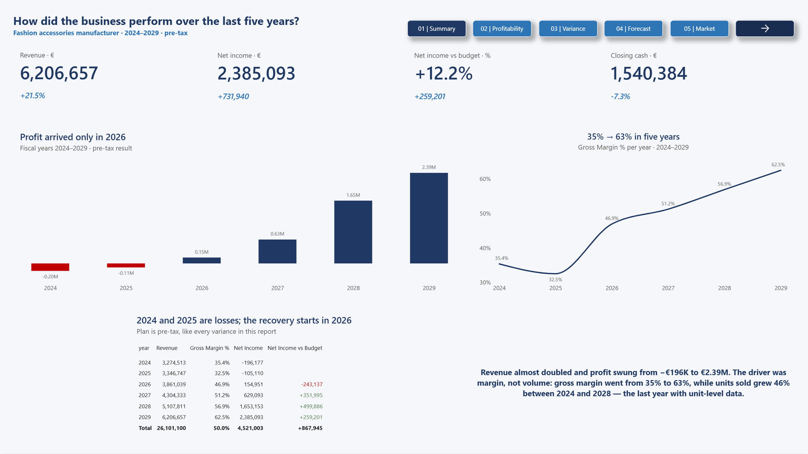
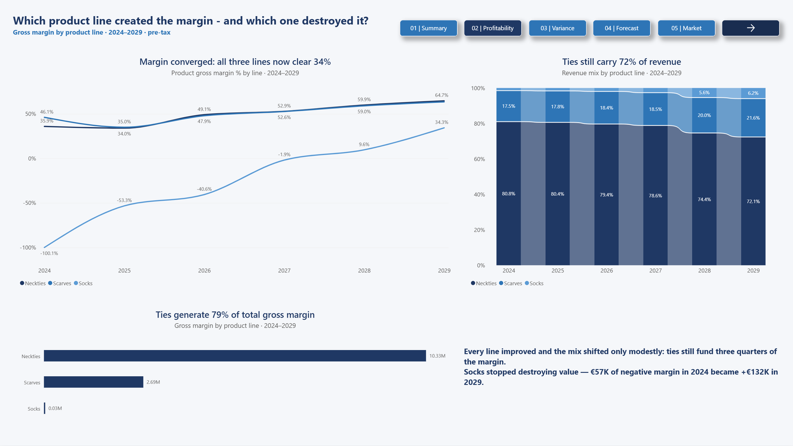
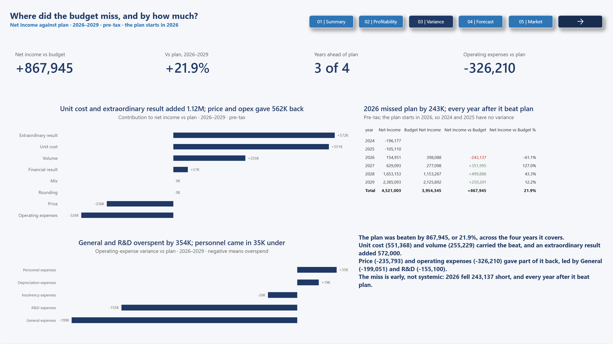
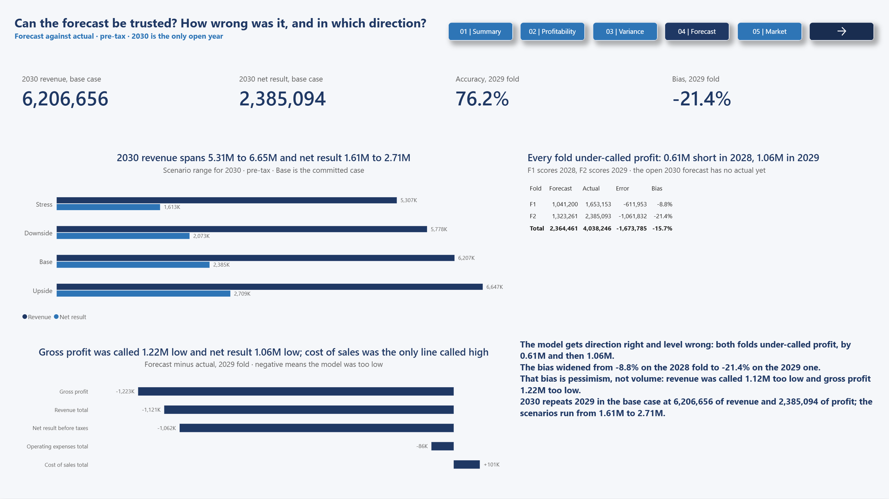
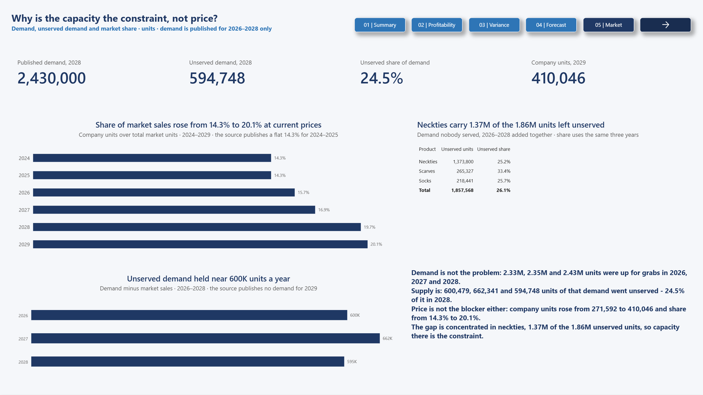

# FP&A Forecasting & Variance Analysis - Caso de estudio: accesorios de moda


Un fabricante de corbatas, bufandas y calcetines creció un 0,9% en ingresos en 2026 y vio
caer su resultado neto un 61%. Un modelo financiero en Python reconstruyó sus estados
contables desde los libros de cierre originales, atribuyó toda la desviación a gastos
operativos y pronosticó los ingresos del año siguiente con un **0,3% de error** - un año
antes, usando solo la información disponible en ese momento.

---

## 📊 Dashboard Ejecutivo (Informe Power BI PBIR, cinco páginas)

Las cinco páginas están construidas, validadas con `powerbi-report-author validate`
y revisadas sobre un render nuevo. Ninguna cifra se escribe antes de ejecutarla
contra el modelo semántico en vivo, en el grano que muestra el visual, y todo el
texto visible está en inglés.

| Página | La pregunta que responde | Titular verificado |
|---|---|---|
| `01 \| Summary` | ¿Cómo se desempeñó el negocio en los últimos cinco años? | Ingresos **€6.206.657**, utilidad neta **€2.385.093**, margen bruto **35,4% → 62,5%** |
| `02 \| Profitability` | ¿Qué línea de producto creó el margen — y cuál lo destruyó? | Las corbatas sostienen **72,1%** del ingreso y **79%** del margen bruto; la línea más débil pasó de **−€57K** a **+€132K** |
| `03 \| Variance` | ¿Dónde falló el presupuesto, y por cuánto? | Utilidad neta vs plan **+€867.945 (+21,9%)**, **3 de 4** años por encima, opex **−€326.210** |
| `04 \| Forecast` | ¿Se puede confiar en el pronóstico? ¿Cuánto falló y en qué dirección? | Fold 2029 **76,2%** de exactitud, sesgo **−21,4%**; base 2030 **€6.206.656** de ingreso y **€2.385.094** de resultado neto |
| `05 \| Market` | ¿Por qué la restricción es capacidad y no precio? | **594.748** unidades sin atender en 2028 (**24,5%** de la demanda), cuota **14,3% → 20,1%** |

**Canvas:** 1920×1080 · `#F5F7FA` · distribución en 12 columnas (139 px de ancho, 16 px de hueco, 32 px de márgenes)
**Paleta:** Primario `#1F3864`, Secundario `#2E75B6`, Neutro `#8C8C8C`, Tarjeta `#FFFFFF`
**Tipografía:** 16 px de título, 11 px de subtítulo, 10 px de etiqueta de tarjeta, 32 px de valor llamada
**Todo el texto 100% inglés** — regla permanente en `dashboard/AGENTS.md`, unidades de visualización incluidas

**Números verificados por DAX en vivo (FY 2026–2029, pre-tax):**
- Plan Net Income: **€3.954.345** | Real: **€4.822.290** | Variación: **+€867.945** (`+21,9%`)
- 2026: **−€243.137** (`−61,1%`) | 2027: **+€351.995** (`+127,0%`)
- 2028: **+€499.886** (`+43,3%`) | 2029: **+€259.201** (`+12,2%`)
- Drivers: Extraordinario **+€572.000** (65,9% del superávit), Costo Unitario **+€551.368**, Volumen **+€255.229**, Sobrecoste Operativo **−€326.210**
- Backtest del pronóstico: fold 2028 **86,9%** de exactitud (sesgo **−8,8%**), fold 2029 **76,2%** (sesgo **−21,4%**), error total **−€1.673.785**

**Report Page Tooltips:** Páginas de tooltip ocultas vinculadas a cada tarjeta KPI y visual, verificadas contra el patrón PBIR trabajado de `tipRevenue`.

---

## El problema de negocio

**1. Los ingresos crecieron. El beneficio se hundió.** En 2026 los ingresos quedaron dentro del 0,9% del presupuesto mientras el resultado neto falló un 61,1%. La cascada es indiscutible:

| Cascada contra presupuesto, 2026 | EUR |
|---|---:|
| Margen bruto por encima | +74.457 |
| Gastos operativos | (359.888) |
| Resultado financiero | +24.294 |
| Resultado extraordinario | +18.000 |
| **Desviación neta** | **(243.137)** |

El mercado respondió. La disciplina de costes no. De la desviación, **150.000 € de gastos generales no tienen respaldo documental**: se registran como hueco visible, no se suavizan. El margen bruto se descompone en precio +41.536, volumen -2.607, mix +1 y coste unitario +35.527.

**2. La empresa estaba limitada por capacidad, no por demanda.** En 2028 el mercado
no pudo servir **594.748 unidades** de demanda: 405.181 corbatas, 112.242 bufandas y
77.325 calcetines. La cuota era del 16,7%, 20,1% y 36,5%: el techo era la producción,
lo que convierte una pregunta comercial en una decisión de asignación de capital.

**3. El presupuesto estaba sesgado, no solo desviado.** Medido sobre resultado antes
de impuestos, el real contra presupuesto fue -61,1% (2026), **+127,0% (2027)**, +43,3% (2028) y
+12,2% (2029). Desde 2027 la empresa superó sistemáticamente su propio plan. Eso no es ruido:
un hábito de presupuestar a la baja oculta necesidades de capacidad y subestima la caja.

---

## El motor de limpieza y procesamiento de datos (`cg_01`)

El motor `cg_01` es la tubería automatizada y auditable que transforma los libros de
trabajo operativos y financieros en bruto en un esquema estrella (18 tablas, 28
relaciones, 94 medidas DAX) consumido por el dashboard de Power BI.

**Ingesta** (`src/cg_01/loader.py`):
- Libros Excel (`data/*.xlsx`), logs de decisiones JSON y bitácoras Markdown
- Verificación SHA-256 en cada ejecución (`sha256_file`)
- Ordenamiento determinista de fuentes (`_sorted_paths`) para que `source_id` nunca se desplace
- Tres tipos de fuente: `excel`, `json`, `markdown` con frontmatter

**Limpieza y Normalización** (`src/cg_01/canonical.py`):
- Detección de cuadrícula, identificación de celdas de período/cuarter
- Parteo de años relativos (`Ano +1`), limpieza de etiquetas, quita de acentos
- Normalización de clave de producto (quitar sufijos `_catalogo_euro`, `_euro`, `_eur`)
- Parsea de decisiones: precios, unidades de producción, selección de CAPEX, porcentajes de descuento
- Detección de anomalías: tolerancia de balance, umbrales de ocupación, corredores de precio

**Salida** (`src/cg_01/pipeline.py` → `write_all_outputs`):
- Exportación de marts a `data/processed/` como CSV para Power BI
- Generación de Markdown (`outputs/markdown/`) con exportación literal celda por celda
- Resumen de anomalías: conteos critical/high/medium/low/info
- Reconciliación de hashes: bandera `all_hashes_unchanged` en cada ejecución

**Garantías de transparencia:**
- Cada cifra lleva un archivo fuente, hoja y coordenada de celda
- Los hashes de las fuentes se verifican en cada ejecución; las discrepancias se marcan como advertencias
- Los logs de decisiones se marcan `pending` cuando contradicen el cierre (ej. el log de 2029)
- 83 tests pytest en identidades contables, integridad referencial, cuadre exacto de la varianza,
  cobertura del backtest y regresiones de identidad de fuentes

**Stack tecnológico:** Python 3.12 · pandas, NumPy, openpyxl · Data marts en esquema galaxia (8
tablas de hechos que comparten 9 dimensiones conformes) · Git y CI (GitHub Actions) · Power BI
(.pbip versionado como TMDL)

**Ejecutando el motor:**
```bash
uv sync --group dev
uv run python -m cg_01              # capa canónica + exportación literal de celdas
uv run python -m cg_01.fpa.marts   # estados, marts y pronóstico 2030
uv run pytest -q                     # 83 tests
```

---

## 📸 Recursos visuales

Las cinco páginas, capturadas desde el canvas del informe a 1920×1080.


*`01 \| Summary` — tarjetas KPI con el P&L de cinco años, tendencia del margen bruto, matriz por año y report page tooltips*


*`02 \| Profitability` — margen por línea de producto, mezcla de ingresos y contribución al margen bruto*


*`03 \| Variance` — plan vs real, puente de drivers y el sobrecosto operativo línea por línea*


*`04 \| Forecast` — banda de escenarios para 2030, exactitud del backtest por fold y error por línea principal*


*`05 \| Market` — demanda publicada, unidades sin atender y cuota de mercado, con la brecha concentrada en corbatas*

---

## Ejecutando el pipeline completo

```bash
uv sync --group dev
uv run python -m cg_01              # capa canónica + exportación literal de celdas
uv run python -m cg_01.fpa.marts   # estados, marts y el pronóstico 2030
uv run pytest -q                     # 83 tests
```

Visite `outputs/markdown/` para el exportación literal celda por celda y
`dashboard/FPA_Case_Study.Report/` para el informe Power BI PBIR.

---

## Transparencia

Este es un **caso de estudio anonimizado construido sobre un simulador de negocio competitivo**, no datos de cliente ni las cuentas de una empresa real. La marca del simulador y la identidad de los otros equipos se han eliminado; el origen se declara porque afirmarlo lo contrario sería trivialmente refutable.

Lo que demuestra es el método: convertir los libros de cierre en bruto en un modelo financiero auditable, encontrar dónde se fue el dinero y probar que un pronóstico merece confianza antes de usarlo.

---

## Reproducirlo

```bash
uv sync --group dev
uv run python -m cg_01            # capa canónica + exportación literal de celdas
uv run python -m cg_01.fpa.marts  # estados, marts y el pronóstico 2030
uv run pytest -q                  # 83 tests
```

Dentro del repositorio: `outputs/markdown/` guarda una exportación literal celda a celda de
cada hoja, `notebooks/01_revision_matrices.ipynb` contiene la revisión exploratoria
de las matrices de origen, y `data/processed/` los marts que consume el dashboard.

Empezar por [`docs/README.md`](docs/README.md) para el método, el modelo de datos y
todas las limitaciones conocidas, o leer la versión inglesa en [`README.md`](README.md).

---

## Licencia

MIT - ver [LICENSE](LICENSE).