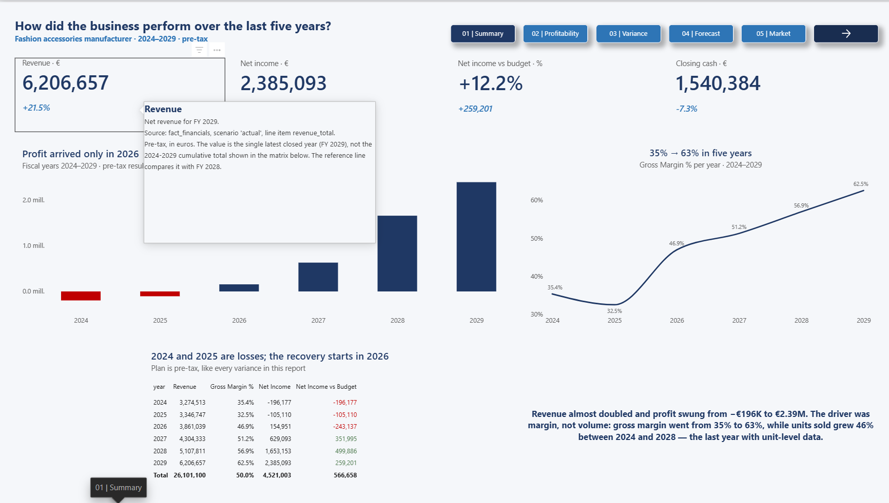
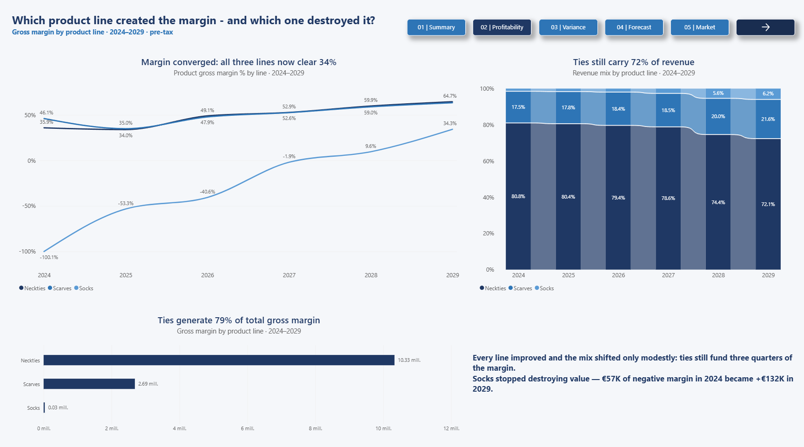

# FP&A Forecasting & Variance Analysis - Fashion Accessories Case Study


A manufacturer of neckties, scarves and socks grew revenue 0.9% in 2026 and watched
net income fall 61%. A Python financial model rebuilt its statements from the raw
closing workbooks, traced the entire miss to operating expenses, and forecast the
next year's revenue within **0.3%** of the actual close - one year ahead, using only
information available at the time.

---

## 📊 Executive Dashboard Status (Power BI PBIR Report)

**Pages completed & verified:**
- `01 | Summary` — DAX-verified KPI cards, tooltip pages, executive header and takeaway
- `02 | Profitability` — Product margin analysis, 12-column grid layout, question-driven titles
- `03 | Variance` — **Built / In Review**: Variance bridge, year-over-year columns, opex breakdown, interactive tooltips (hover captures available)

**Canvas:** 1920×1080 · `#F5F7FA` · 12-column grid (139 px columns, 16 px gutter, 32 px margins)
**Palette:** Primary `#1F3864`, Secondary `#2E75B6`, Neutral `#8C8C8C`, Card `#FFFFFF`
**Typography:** 16 px title, 11 px subtitle, 10 px card label, 32 px callout value
**All text 100% English** — permanent rule in `dashboard/AGENTS.md`

**Live DAX-verified numbers (FY 2026–2029, pre-tax):**
- Plan Net Income: **€3,954,345** | Actual: **€4,822,290** | Variance: **+€867,945** (`+21.9%`)
- 2026: **−€243,137** (`−61.1%`) | 2027: **+€351,995** (`+127.0%`)
- 2028: **+€499,886** (`+43.3%`) | 2029: **+€259,201** (`+12.2%`)
- Drivers: Extraordinary **+€572,000** (65.9% of surplus), Unit Cost **+€551,368**, Volume **+€255,229**, Opex overrun **−€326,210**

**Report Page Tooltips:** Hidden tooltip pages bound to every KPI card and visual, verified against the working PBIR pattern from `tipRevenue`.

---

## The business problem

**1. Revenue grew. Profit collapsed.** In 2026 revenue landed within 0.9% of budget
while net income missed by 61.1%. The bridge is unambiguous:

| Bridge to budget, 2026 | EUR |
|---|---:|
| Gross margin beat | +74,457 |
| Operating expenses | (359,888) |
| Financial result | +24,294 |
| Extraordinary result | +18,000 |
| **Net variance** | **(243,137)** |

The market showed up. The cost discipline did not. Of the overrun, **?150,000 of
general expenses has no documentary support** - it is carried as a visible gap, not
smoothed away. Gross margin itself broke down into price +41,536, volume -2,607,
mix +1 and unit cost +35,527.

**2. The company was capacity-constrained, not demand-constrained.** In 2028 the
market could not serve **594,748 units** of demand: 405,181 neckties, 112,242
scarves, 77,325 socks. Market share was 16.7%, 20.1% and 36.5% - the ceiling was
production, which turns a commercial question into a capital-allocation decision.

**3. The budget was biased, not merely inaccurate.** Measured on profit before
taxes, actual versus budget ran -61.1% (2026), **+127.0% (2027)**, +43.3% (2028) and
+12.2% (2029). From 2027 onward the company systematically beat its own plan. That
is not noise: an under-budgeting habit hides capacity needs and understates cash.

---

## The Data Cleaning & Processing Engine (`cg_01`)

The `cg_01` engine is the automated, auditable pipeline that transforms raw operational
and financial workbooks into a star schema (18 tables, 28 relationships, 46 DAX measures)
consumed by the Power BI dashboard.

**Ingestion** (`src/cg_01/loader.py`):
- Excel workbooks (`data/*.xlsx`), JSON decision logs, and Markdown bitácoras
- SHA-256 hash verification on every run (`sha256_file`)
- Deterministic source ordering (`_sorted_paths`) so `source_id` never shifts
- Three source types: `excel`, `json`, `markdown` with frontmatter

**Cleaning & Normalization** (`src/cg_01/canonical.py`):
- Grid detection, period/quarter cell identification
- Relative year parsing (`Ano +1`), label cleaning, accent stripping
- Product key normalization (stripping `_catalogo_euro`, `_euro`, `_eur` suffixes)
- Decision parsing: prices, production units, CAPEX selection, discount percentages
- Anomaly detection: balance tolerance, occupancy thresholds, price corridors

**Output** (`src/cg_01/pipeline.py` → `write_all_outputs`):
- Mart export to `data/processed/` as CSV for Power BI
- Markdown generation (`outputs/markdown/`) with literal cell-by-cell export
- Anomaly summary: critical/high/medium/low/info counts
- Hash reconciliation: `all_hashes_unchanged` flag on each run

**Transparency guarantees:**
- Every figure carries a source file, sheet and cell coordinate
- Source hashes verified on every run; mismatches flagged as warnings
- Decision logs marked `pending` when they contradict the close (e.g., 2029 log)
- 74 pytest tests on accounting identities, referential integrity, exact variance tie-out,
  backtest coverage, and source-identity regressions

**Tech stack:** Python 3.12 · pandas, NumPy, openpyxl · Galaxy-schema data marts (8 fact
tables sharing 9 conformed dimensions) · Git and CI (GitHub Actions) · Power BI
(.pbip versioned as TMDL)

**Running the engine:**
```bash
uv sync --group dev
uv run python -m cg_01              # canonical layer + literal cell export
uv run python -m cg_01.fpa.marts   # statements, marts and the 2030 forecast
uv run pytest -q                     # 74 tests
```

---

## 📸 Visual Assets


*Page 01 | Summary — KPI cards, header title/subtitle, navigation row, and hover tooltips*


*Page 02 | Profitability — product margin analysis, 12-column grid, navigation buttons*

---

## Running the full pipeline

```bash
uv sync --group dev
uv run python -m cg_01              # canonical layer + literal cell export
uv run python -m cg_01.fpa.marts   # statements, marts and the 2030 forecast
uv run pytest -q                     # 74 tests
```
Visit `outputs/markdown/` for the literal cell-by-cell export and
`dashboard/FPA_Case_Study.Report/` for the Power BI PBIR report.

---

## Transparency

This is an **anonymised case study built on a competitive business simulation**, not
client data and not a real company's books. The simulation brand and the identity of
the other teams are removed; the origin is disclosed because claiming otherwise would
be trivially falsifiable.

What it demonstrates is the method: turning raw closing workbooks into an auditable
financial model, finding where the money went, and proving a forecast can be trusted
before it is used.

---

## Reproduce it

```bash
uv sync --group dev
uv run python -m cg_01            # canonical layer + literal cell export
uv run python -m cg_01.fpa.marts  # statements, marts and the 2030 forecast
uv run pytest -q                  # 74 tests
```

Inside the repository: `outputs/markdown/` keeps a literal cell-by-cell export of
every sheet, `notebooks/01_revision_matrices.ipynb` holds the exploratory review
of the source matrices, and `data/processed/` holds the marts the dashboard reads.

Start with [`docs/README.md`](docs/README.md) for the method, the data model and
every known limitation, or read the Spanish version at
[`README.es.md`](README.es.md).

---

## License

MIT - see [LICENSE](LICENSE).